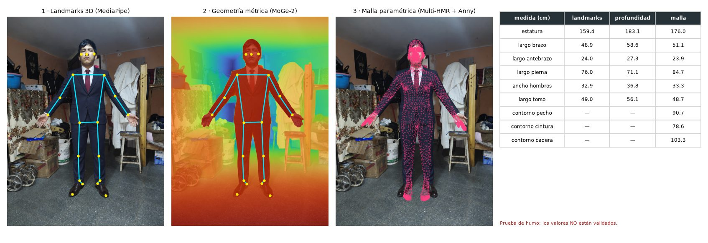
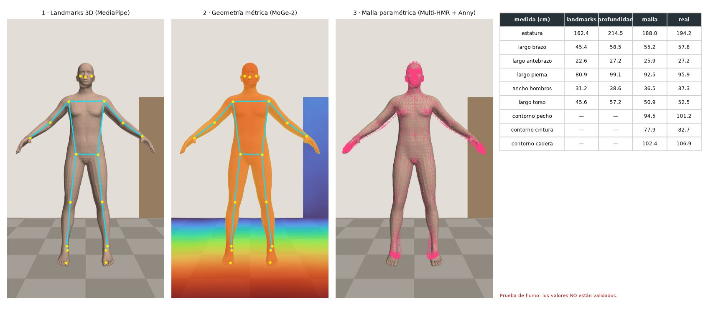

# Estatura y largos desde una sola foto (experimental)

Rama `manuel/medidas-monoculares`. Explora si la estatura, el largo de brazo y
otras medidas pueden salir de una foto en lugar de escribirse o de depender de
priors fijos. **No toca el runtime oficial**: `configs/modelos_runtime.json` y
la ruta de dos siluetas siguen igual.

Estado: los tres métodos corren de punta a punta en una GTX 1650 Ti de 4 GB.
**No hay evaluación de calidad todavía**; los números de abajo son de una
prueba de humo y no deben leerse como precisión.

## Cómo se hace hoy

- La **estatura no se estima**: el usuario la escribe y es el ancla métrica de
  todo (`ancho_cm ≈ ancho_px / alto_corporal_px × estatura_cm` en
  `src/features/silhouette_profiles.py`).
- Los **largos** (brazo, pierna) salen del regresor `exp_008` sobre siluetas.
  `docs/ROADMAP_TECNICO.md` §1.1 ya mostró que en la práctica devuelven una
  fracción casi fija de la estatura: la silueta en pose A no contiene el largo
  del brazo. En la prueba real el brazo falló por −5,3 cm.
- `scripts/experimento_estimabilidad_estatura.py` acota lo que se puede sacar
  de proporciones sin escala. Los métodos de aquí atacan justo eso: obtienen la
  **escala** de otra fuente (profundidad métrica o un prior de cuerpo aprendido).

## Los tres métodos

| | 1 · `landmarks` | 2 · `profundidad` | 3 · `malla` |
|---|---|---|---|
| Modelo | MediaPipe Pose Heavy (BlazePose GHUM) | MoGe-2 ViT-S + landmarks 2D | Multi-HMR ViT-L + cuerpo Anny |
| Idea | La red regresa 33 articulaciones 3D en metros | Mapa de puntos 3D métrico de toda la escena; se lee sobre la persona | Regresa pose y fenotipo de un cuerpo paramétrico; se mide la malla en reposo |
| De dónde sale la escala | Prior implícito de la red | Contexto de la escena (suelo, muebles, puertas) | Prior de cuerpo humano + cámara estimada |
| Medidas | estatura, largos | estatura, largos | estatura, largos y contornos (pecho, cintura, cadera) |
| Pesos | 30 MB | 141 MB | 1,5 GB |
| Tiempo por foto (GTX 1650 Ti) | 0,1–0,3 s (CPU) | ~2,2 s | ~5 s (1,9 GB de VRAM observados) |
| Licencia | Apache 2.0 | MIT | Anny Apache 2.0; **código y checkpoint Multi-HMR no comerciales** |
| Código | `metodo_landmarks.py` | `metodo_profundidad.py` | `metodo_malla.py`, `medidas_malla.py` |

Todo vive en `src/medidas_monoculares/`. Las definiciones de cada medida están
en `comun.MEDIDAS`: son distancias entre centros articulares o sobre la malla,
**no recorridos de cinta ni definiciones BodyM**, así que todavía no son
comparables 1:1 con las 13 medidas oficiales.

Descartados por ahora: SAM 3D Body (checkpoint de 2,1 GB con acceso restringido
y no cabe con holgura en 4 GB), Depth Pro (1,9 GB), SHAPY y el resto de la
familia SMPL/SMPL-X (exigen registro para descargar el modelo corporal; SHAPY
ya está en el repositorio, fuera del runtime).

## Ejecutar

```bash
bash scripts/medidas_monoculares/preparar_entorno.sh            # entorno + modelos (~1,7 GB de pesos)
bash scripts/medidas_monoculares/preparar_entorno.sh --sin-malla  # sin el método 3 (~170 MB)

.venv-medidas/bin/python scripts/medidas_monoculares/demo.py                 # 3 fotos de muestra del repo
.venv-medidas/bin/python scripts/medidas_monoculares/demo.py foto.jpg --estatura-real 165
.venv-medidas/bin/python scripts/medidas_monoculares/demo.py carpeta/ --metodos landmarks,profundidad

# Cuerpos sintéticos con medidas reales conocidas (no descarga nada)
.venv-medidas/bin/python scripts/medidas_monoculares/generar_sinteticos.py --cantidad 3
.venv-medidas/bin/python scripts/medidas_monoculares/demo.py outputs/medidas_monoculares/sinteticos \
    --salida outputs/medidas_monoculares/sinteticos/resultados

.venv-medidas/bin/python -m pytest tests/test_medidas_monoculares.py   # geometría, sin modelos
```

Requiere Linux, `uv` y, para la GPU, un driver NVIDIA reciente. El entorno
(`.venv-medidas`, ~6 GB por PyTorch con CUDA) es independiente de los entornos
conda del runtime. `--dispositivo cpu` está probado con `landmarks` y
`profundidad`; `malla` en CPU no se ha probado. Los pesos
van a `pretrained/` y Multi-HMR a `vendor/`; ninguno se versiona. La primera
ejecución de `malla` baja además el código de DINOv2 con `torch.hub` (pocos MB).

Por cada foto, `demo.py` escribe en `outputs/medidas_monoculares/` un JSON con
las medidas de cada método y un PNG con el panel comparativo.

## Resultados de muestra

Foto real del repositorio (sin medidas de referencia):



Cuerpo sintético con medidas reales conocidas:



Estatura en cm sobre los tres sintéticos de `--semilla 7`:

| Sintético | Real | `landmarks` | `profundidad` | `malla` |
|---|---:|---:|---:|---:|
| 00 | 163,8 | 163,0 | 202,4 | 173,3 |
| 01 | 159,7 | 163,2 | 188,3 | 168,9 |
| 02 | 194,2 | 162,4 | 214,5 | 188,0 |

Tres imágenes de maniquíes sin ropa no miden precisión, pero ya dejan ver el
comportamiento de cada método:

- **`landmarks` devuelve ~163 cm para todos**, también para el de 194 cm. La
  escala de MediaPipe es un prior poblacional, no una medición. Sirve para
  proporciones, no para estatura absoluta.
- **`profundidad` sigue el orden correcto pero con errores de escala grandes**
  (+10 % a +24 % aquí). En la foto de estudio con fondo
  blanco (`male-navy-suit-model-reference-v1.png`) da 275 cm: sin contexto no
  hay de dónde sacar la escala.
- **`malla` es el más cercano** (+9,5, +9,2 y −6,2 cm) y el único que da
  contornos, pero tiende hacia la estatura media.

## Limitaciones conocidas

- La estatura de `profundidad` incluye pelo y calzado; la de `malla` es la del
  cuerpo descalzo. No son la misma magnitud.
- `profundidad` usa la máscara de persona de MediaPipe, que se desborda sobre
  el fondo; se filtra por profundidad (`MARGEN_PROFUNDIDAD_M`), no con SAM 2.1.
- Los contornos de `malla` dependen de bandas de altura fijas (`BANDAS` en
  `medidas_malla.py`) sin validar contra cinta.
- Con ropa holgada `malla` estima el cuerpo que "cree" que hay debajo; los
  otros dos miden la superficie de la ropa.
- Multi-HMR + Anny es de uso no comercial: válido para la tesis, bloquea una
  comercialización sin sustituirlo.
- Un error del 3 % en estatura ya gasta el presupuesto de ±2 cm de los
  contornos (ROADMAP §2.1). Ningún método está hoy cerca de eso en estatura.

## Siguientes pasos

1. **Evaluación real**: 15–30 personas con estatura y largos medidos, foto
   frontal con el protocolo de captura. Reportar por medida (MAE, sesgo, % ≤ 2 cm).
2. **Medir los largos como proporción de la estatura escrita**: los tres
   métodos dan `largo_brazo / estatura` sin depender de la escala absoluta. Es
   el uso más prometedor a corto plazo y ataca directamente el fallo del brazo.
3. **Escala por plano del suelo** en `profundidad`: medir la altura de la
   cabeza sobre el suelo ajustado en vez de la extensión de la silueta.
4. Probar MoGe-2 ViT-B/L y Depth Pro si hay una GPU mayor.
5. Alinear las definiciones con BodyM antes de comparar con `exp_008`.

## Fuentes

- [MoGe-2](https://github.com/microsoft/MoGe) · [pesos ViT-S](https://huggingface.co/Ruicheng/moge-2-vits-normal)
- [Multi-HMR](https://github.com/naver/multi-hmr) · [licencia del checkpoint Anny](https://download.europe.naverlabs.com/ComputerVision/MultiHMR/Checkpoint_License_Anny.txt)
- [Anny](https://github.com/naver/anny) · [artículo](https://arxiv.org/abs/2511.03589)
- [MediaPipe Pose Landmarker](https://ai.google.dev/edge/mediapipe/solutions/vision/pose_landmarker)
- [SAM 3D Body](https://huggingface.co/facebook/sam-3d-body-dinov3) · [Depth Pro](https://huggingface.co/apple/DepthPro-hf) · [SHAPY](https://github.com/muelea/shapy)
